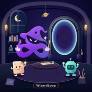
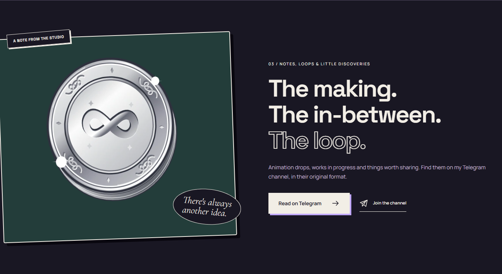

<p align="center">
  
</p>

<h1 align="center">WizardLoop</h1>

<p align="center"><strong>Code, Design &amp; a Little Magic.</strong></p>

<p align="center">
  <a href="https://wizardloop.com">Visit my website</a> ·
  <a href="https://t.me/wizard_loop">Follow my channel</a> ·
  <a href="https://t.me/wizardloopchat">Join my community</a>
</p>

<p align="center">
  <a href="https://github.com/WizardLoop/wizardloop.github.io/actions/workflows/deploy.yml"></a>
</p>

I'm WizardLoop, an independent creator working across design, illustration, animation, software, Telegram bots and open source. This repository is the source of my personal website, [wizardloop.com](https://wizardloop.com).

I build with Astro and publish static HTML on GitHub Pages. My illustrations and motion live alongside direct links to my work, community and contact details. Running my website needs no credentials or separate application server.

[Quick start](#quick-start) · [Editing guide](#editing-guide) · [Quality checks](#quality-checks) · [Publishing](#publishing) · [Documentation](#documentation) · [License](#license-and-contact)



*My own artwork, original SVG details and local animation assets. Explore [desktop and mobile captures](docs/QA.md#visual-review) from my local review of the version now published.*

## Project status

| Published website | Repository update |
| --- | --- |
| **1.0.0-rc.3** · Published **2026-10-28** | **1.0.0-rc.4** · Published **2026-10-29** |
| [PR #5](https://github.com/WizardLoop/wizardloop.github.io/pull/5) · [Successful deployment](https://github.com/WizardLoop/wizardloop.github.io/actions/runs/40700122492) | I am improving repository presentation, guides and publication records. |

I verified the published site at merge commit `062bdad`. My rc.4 update changes documentation and package version metadata only; it does not change the website interface or behavior. Publication, a package version and a GitHub Release are separate events. See my [changelog](CHANGELOG.md) for their history.

## Quick start

Use **Node.js 22.23.4 or newer** and npm. My GitHub workflows use Node 24.

```sh
git clone https://github.com/WizardLoop/wizardloop.github.io.git
cd wizardloop.github.io
npm ci
npm run dev
```

Open **[127.0.0.1:4322](http://127.0.0.1:4322)**. To review a pull request, check out its branch first. Make changes on a dedicated branch.

To inspect the production build locally:

```sh
npm run build
npm run preview
```

Stop the development server before starting the preview on the same port. `dist/` contains the complete publishable site. Local commands do not deploy it.

No `.env` file is required. The optional `PUBLIC_PREVIEW=true` setting in [.env.example](.env.example) makes a review build non-indexable; my production workflow explicitly disables it. Never put a secret in a `PUBLIC_` variable.

## Editing guide

| I want to change | Where I edit |
| --- | --- |
| Identity, verified links, email and navigation | [src/config/site.ts](src/config/site.ts) |
| Page copy, routes and metadata | [src/pages/](src/pages/) |
| My profile text and image metadata | [profile.json](public/media/profile/profile.json) |
| Local profile media | [public/media/profile/](public/media/profile/) |
| Colors, typography and shared layouts | [global.css](src/styles/global.css) |
| Destination-page layouts | [destinations.css](src/styles/destinations.css) |
| Header, footer and shared metadata | [Base.astro](src/layouts/Base.astro) |
| SVG icons and reusable artwork | [src/components/](src/components/) |
| Navigation, theme and motion | [src/scripts/](src/scripts/) and [preferences.js](public/js/preferences.js) |
| Artwork provenance and inventory | [artworks.json](src/content/artworks.json) and [flags.json](src/content/flags.json) |

I write personal copy in first person. I keep claims and links verified, record media rights, provide useful alternative text and preserve image dimensions. Controlled text, metadata and documentation use a regular hyphen instead of U+2014; my source checks enforce this rule.

I update my profile locally. Changing my Telegram or GitHub profile does not change this site automatically. Work and Posts link to my original Telegram content; Projects links to all my GitHub repositories. My asset inventories preserve provenance and do not generate a public portfolio gallery.

## Quality checks

```sh
npm run check
npx playwright install chromium firefox webkit
npm run test:browsers
```

On Linux, install browser system dependencies with `npx playwright install --with-deps chromium firefox webkit`. Stop any existing server on port 4322 before browser tests so they use the built site.

| Command | What I check or generate |
| --- | --- |
| `npm run check` | Formatting, source invariants, typecheck and static build |
| `npm run format` / `npm run format:check` | Website source and selected configuration formatting |
| `npm run lint` / `npm run typecheck` | Source rules or Astro/TypeScript diagnostics separately |
| `npm run build` | Brand assets, media previews, HTML, metadata, links and CNAME |
| `npm test` | Chromium browser suite |
| `npm run test:browsers` | Chromium suite and selected Firefox/WebKit checks |
| `npm run audit:performance` | Six-page Lighthouse audit against the running built preview |
| `npm run media:poster -- silver-grimoire` | Manual still-poster generation for artwork editing |

My [QA report](docs/QA.md) separates measured versions and environments. The rc.3 evidence includes 185 passing Linux browser checks, 432 responsive viewport cases and 24 axe checks. I retain the lower Windows Home performance measurements alongside the stronger Linux results. Historical results do not validate a new revision, and automated checks do not establish full accessibility or legal conformance.

Branch and PR checks cannot deploy. CI retains browser evidence and six-page Lighthouse reports for seven days. Audit execution errors fail the check; numerical scores are recorded without a fixed pass threshold. Local reports go to ignored `artifacts/final/` and `artifacts/lighthouse/`.

For a documentation-only change, review the prose, links, images and version consistency, then run `npm run check`. My existing CI still runs its full browser and performance suite. I do not label unchanged screenshots as a fresh visual review.

## How my site works

| Layer | Approach |
| --- | --- |
| Pages | Astro generates complete HTML for 12 routes, including a custom 404. |
| Navigation | Directory URLs support direct navigation and refreshes on GitHub Pages. |
| Visual identity | My local illustrations, SVG details, fonts, light/dark themes and motion preferences. |
| Contact and content | Ordinary Telegram, email and GitHub links, including Contact at the retained `/feedback/` URL. |
| Hosting | GitHub Pages publishes only `dist/` at `wizardloop.com`. |

I serve fonts, icons, profile media and animation code locally. I do not operate a feedback form, CAPTCHA, embedded feed, automatic profile/post synchronization or message-delivery backend. External links open their destination service, whose terms and privacy practices apply.

<details>
<summary><strong>Animation, posters and social artwork</strong></summary>

My Home hero uses two native 768 x 768 H.264 MP4 derivatives of my `portal-alchemy` artwork, one per theme, with the original 2.4-second duration. Other TGS artwork uses a shared, lazy-loaded light Canvas Lottie player. I cache animation source data and isolate each player's mutable copy. Reduced-motion preferences, visibility and my global motion control limit playback; still previews remain available when playback fails.

I use Silver Grimoire on Home, About and Posts. My build creates quality-94 WebP delivery copies from unchanged lossless poster masters, preserving dimensions and transparency.

To regenerate a still while editing an animation, install Playwright Chromium and run:

```sh
npx playwright install chromium
npm run media:poster -- silver-grimoire
npm run media:poster -- silver-grimoire 0.35
```

The optional frame fraction ranges from 0 up to, but not including, 1. The default is 0.35. This manual editing step requires a browser; an ordinary static build does not.

My build also regenerates favicons and a 1200 x 630 social image from my local avatar and original artwork. After a manual avatar change, run `npm run build` or `node scripts/generate-brand.mjs`. Social-card typography uses installed Arial or a sans fallback and can vary by operating system; I do not redistribute a system font.

</details>

<details>
<summary><strong>Earlier local design studies</strong></summary>

```sh
npm run dev:concepts
```

Open `http://127.0.0.1:4321/concept-a/`, `/concept-b/` or `/concept-c/`. I keep these three original studies non-indexable and outside `dist/`. The `test:concepts` and `test:concept-interactions` scripts exercise that historical review material.

</details>

## Publishing

Merging a reviewed change into `main` triggers my Pages workflow, including documentation-only changes. It checks the source, builds the site and runs browser tests before uploading and deploying `dist/`. A failed build or test blocks publication.

**Pages must use Settings > Pages > Build and deployment > Source: GitHub Actions.** The separate legacy Jekyll builder cannot parse Astro frontmatter. I preserve `wizardloop.com`, HTTPS and both source CNAME files. Source changes alone cannot set the account's publishing mode.

I keep the original root HTML and PaperMod-attributed CSS for recovery; they are not the rebuilt site's publishing artifact. My custom domain needs no repository-name base path.

No Cloudflare account, server, bot token, CAPTCHA key or personal access token is required. GitHub provides the workflow's built-in token and short-lived deployment identity. I review tags and Releases separately; merging does not create them.

Follow my [deployment guide](docs/DEPLOYMENT.md) for setup, verification, retries and rollback.

## Documentation

| Guide | Purpose |
| --- | --- |
| [Changelog](CHANGELOG.md) | Version history and verified publication records |
| [Quality review](docs/QA.md) | Measured results, screenshots and known limits |
| [Deployment and recovery](docs/DEPLOYMENT.md) | GitHub Pages setup, publishing and rollback |
| [Current service boundaries](docs/QA-INTEGRATIONS.md) | What my static site does and does not connect to |
| [Asset inventory](docs/DESIGN-ASSET-INVENTORY.md) | Provenance and media rights |
| [Contributing](CONTRIBUTING.md) | Local work, content conventions and review |
| [Security](SECURITY.md) | Private vulnerability reporting |
| [Code of conduct](CODE_OF_CONDUCT.md) | Participation expectations |
| [Third-party notices](THIRD_PARTY_NOTICES.md) | Code, font and asset licenses |

My [initial repository audit](docs/REPOSITORY-AUDIT.md) and [integration feasibility notes](docs/INTEGRATION-FEASIBILITY.md) are historical research. They do not describe active synchronization or feedback services.

## License and contact

I license my website source code and tooling under **[MIT](LICENSE)**. My name, branding, illustrations, avatar, animation media and personal content are outside that grant. Fonts and third-party assets retain their own licenses, documented in [THIRD_PARTY_NOTICES.md](THIRD_PARTY_NOTICES.md).

[Message me](https://t.me/wizardloop) · [Email me](mailto:wizard@wizardloop.com) · [My channel](https://t.me/wizard_loop) · [My community](https://t.me/wizardloopchat) · [GitHub](https://github.com/WizardLoop)
